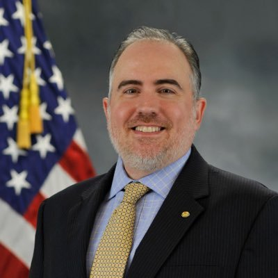
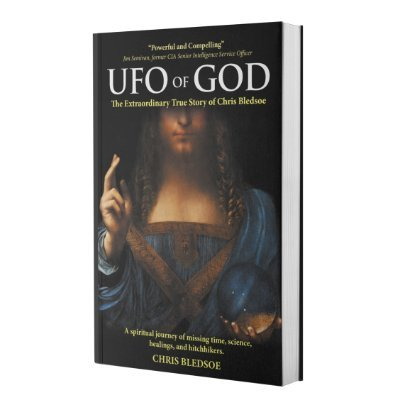
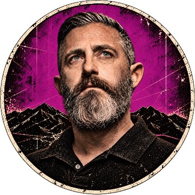
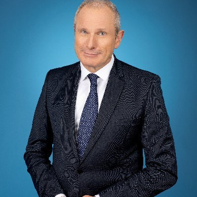
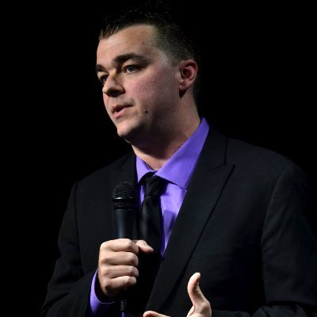
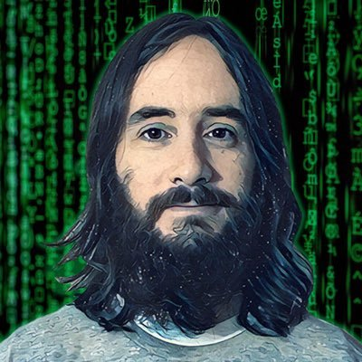
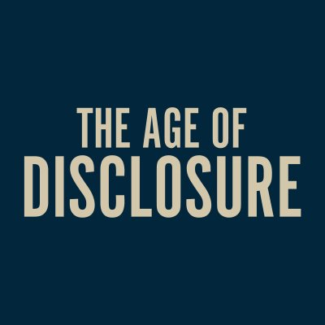
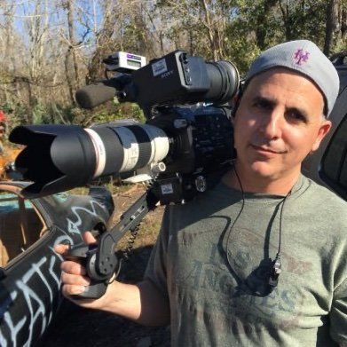
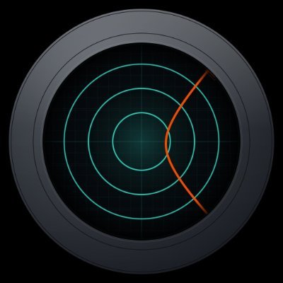

# 🛸 Science Bob News — UAP / UFO / USO SITREP
*Updated 2026-10-28 18:00 UTC · auto-generated · sources credited & linked · reliability ratings are automated, not editorial*

Science Bob News is an automated situation report of public UAP, UFO, and USO claims. Each cycle it reads public social posts and disclosure-podcast feeds, collapses reposts and brid.gy mirrors to one account, and counts another account only when it confirms the same claim. The letter rates the source from A to F, the digit rates the information from 1 to 6, and validity is the McGwier b2.81 score capped by that evidence, never above 0.90. A high score is not a claim that an object was non-human, and it is not a count of how often such reports are later confirmed.

Accumulating cases since the first recorded case, 27 June 2026, 07:38 UTC.

Letter is the source (A completely reliable … F unknown). Digit is the information (1 confirmed by other sources … 4 doubtful, 5 improbable). Validity is the b2.81 score when that scorer is on, and it cannot exceed what the evidence supports. It is not a claim that the object was non-human, and it is not a field frequency.

## Corroborated
_No corroborated reports this cycle._

## Developing / unconfirmed

1. UAP document report — @setiinstitute, California — reliability D1 · validity 0.55 · 3 source(s)  
   [@KilleansRow@mastodon.online](https://mastodon.online/@KilleansRow/117516310782683843) · [@setiinstitute](https://mastodon.social/@setiinstitute/117509693445581656)
   > 3/n...attentional development. It's a mixed bag to be sure ; our experiences and the environs they occur in have huge effect in forming our " filters ". How much is engineered in advance vs synthesiz… · 🛸 Newly released Pentagon files detail UFO sightings over California's Catalina Island in the 1940s and 1950s. But do these decades-old reports suggest extraterrestrial visitors? SETI Institute Presi…
   Source is not usually reliable (D). The report is confirmed by independent sources (1). 3 accounts on the same claim, from 2 posts. Validity 0.55.
   _D1 — source not usually reliable, information confirmed by independent sources. 3 accounts on the same claim (2 posts). 1 other account in the cluster do not confirm that claim. the text names a place, a sensor, or an official record. validity 0.55. publisher-floor. Science Bob's minimum for @setiinstitute is 0.55, and he counts himself as a repeat. Science Bob is two independent sources on this account, so the information digit is 1._

2. UAP document report — @veryexcitingtime — reliability D4 · validity 0.15 · 1 source(s)  
   [@veryexcitingtime](https://mastodon.social/@veryexcitingtime/117504875874752934)
   > 🛸 The Pentagon has a new legal waiver for # UAP disclosure, but it has some concerning gaps. Also the new government # UFO files include the AAWSAP reports… or do they? https:// veryexcitingtime.com/…
   Source is not usually reliable (D). The report is doubtful (4). 1 account on the same claim, from 1 post. Validity 0.15.
   _D4 — source not usually reliable, information doubtful. 1 account on the same claim (1 post). the text names a place, a sensor, or an official record. validity 0.15. mcgwier-b2.81._

3. UAP document report — @researchbuzz_firehose@rbfirehose.com — reliability D4 · validity 0.15 · 1 source(s)  
   [@researchbuzz_firehose@rbfirehose.com](https://rbfirehose.com/2026/10/28/us-dod-department-of-war-publishes-seventh-release-of-unidentified-anomalous-phenomena-files-on-war-gov-ufo/)
   > US DoD: Department of War Publishes Seventh Release of Unidentified Anomalous Phenomena Files on WAR.GOV/UFO. “Today, the Department of War is publishing the seventh release of declassified and histo…
   Source is not usually reliable (D). The report is doubtful (4). 1 account on the same claim, from 1 post. Validity 0.15.
   _D4 — source not usually reliable, information doubtful. 1 account on the same claim (1 post). the text names a place, a sensor, or an official record. validity 0.15. mcgwier-b2.81._

4. UAP discussion — @vibewire@mastodon.au — reliability D4 · validity 0.15 · 1 source(s)  
   [@vibewire@mastodon.au](https://mastodon.au/@vibewire/117519579809012197)
   > An Entire Civilization Beneath North America… With Pyramids 10 Times Bigger Than Giza! http:// dlvr.it/TW5Y2h # UFO # UFONews # ufodisclosure · An Unusual Client, a Congressman and Roswell | Reality Check http:// dlvr.it/TW5QvN # UFO # UFONews # ufodisclosure · The Secret Government Operation Faking Alien Abductions http:// dlvr.it/TW4yDj # UFO # UFONews # ufodisclosure · Roswell Crash: Minute by Minute | Full Film…
   Source is not usually reliable (D). The report is doubtful (4). 1 account on the same claim, from 6 posts. Validity 0.15.
   _D4 — source not usually reliable, information doubtful. 1 account on the same claim (6 posts). 5 repost or mirror collapsed. no sensor reading or official record tied to this claim. validity 0.15. mcgwier-b2.81._

5. UAP sighting report — @AlcorNews — reliability D4 · validity 0.15 · 1 source(s)  
   [@alcornews.bsky.social@bsky.brid.gy](https://fed.brid.gy/r/https://bsky.app/profile/did:plc:3l5f3rhsngpxljnskia73bj7/post/3mytv6x6yi22k) · [@AlcorNews](https://mastodon.social/@AlcorNews/117512082353700013)
   > Chine : Un objet noir flotte dans le ciel de Mui Wo. C'est quel brevet? #OVNI #ObservationInsolite #MuiWo #HongKong #ObjetVolant #PhenomeneAerien #Mystere #UFO #UFO #UAP #MuiWo #HongKong #Unidentifie… · Chine : Un objet noir flotte dans le ciel de Mui Wo. C'est quel brevet? # OVNI # ObservationInsolite # MuiWo # HongKong # ObjetVolant # PhenomeneAerien # Mystere # UFO # UFO # UAP # MuiWo # HongKong…
   Source is not usually reliable (D). The report is doubtful (4). 1 account on the same claim, from 2 posts. Validity 0.15.
   _D4 — source not usually reliable, information doubtful. 1 account on the same claim (2 posts). 1 repost or mirror collapsed. no sensor reading or official record tied to this claim. validity 0.15. mcgwier-b2.81._

## Disclosure podcasts

1. Bigfoot, Dogman & Terrifying Cryptid Encounters — reliability C4 · validity 0.5 · 2 source(s)  
   [@SpacedOutRadio](https://www.youtube.com/watch?v=a0Tzc8CaBEA)  
   📹 [video](https://www.youtube.com/watch?v=a0Tzc8CaBEA)
   > Bigfoot, Dogman & Terrifying Cryptid Encounters. October 23, 2026 - Daniel Hamilton Daniel “Dano” Hamilton is the creator and host of The Cryptid Podcast, a growing show dedicated to eyewitness encou…
   Source is fairly reliable (C). The report is doubtful (4). 2 accounts on the same claim, from 1 post. Validity 0.50.
   _C4 — source fairly reliable, information doubtful. 2 accounts on the same claim (1 post). the text names a place, a sensor, or an official record. a show episode, not an independent sighting. validity 0.50. publisher-floor. Science Bob's minimum for Dave Scott on Spaced Out Radio is 0.50. He has been on that show 100 times and counts himself as a repeat._

2. #35 WHY DO ROCKSTARS SEE UFOS? — Sound, Light & Frequency — reliability C4 · validity 0.4 · 2 source(s)  
   [@NeedToKnow](https://www.youtube.com/watch?v=GgjkPj3nh98)  
   📹 [video](https://www.youtube.com/watch?v=GgjkPj3nh98)
   > #35 WHY DO ROCKSTARS SEE UFOS? — Sound, Light & Frequency. What happens when a rock star goes looking for the people who supposedly know the truth about UFOs—and actually finds them? In “Why Do Rocks…
   Source is fairly reliable (C). The report is doubtful (4). 2 accounts on the same claim, from 1 post. Validity 0.40.
   _C4 — source fairly reliable, information doubtful. 2 accounts on the same claim (1 post). the text names a place, a sensor, or an official record. a show episode, not an independent sighting. validity 0.40. publisher-floor. Science Bob's validity for a disclosure podcast is 0.40, and he counts himself as an independent source._

3. UFO Secrets, UAP Stories and Government Secrets on NHI — reliability C4 · validity 0.5 · 2 source(s)  
   [@SpacedOutRadio](https://www.youtube.com/watch?v=seNQZdUu_WM)  
   📹 [video](https://www.youtube.com/watch?v=seNQZdUu_WM)
   > UFO Secrets, UAP Stories and Government Secrets on NHI. October 14, 2026 - Courtney Marchesani Courtney Marchesani is an author, researcher, and citizen journalist whose work explores the intersectio…
   Source is fairly reliable (C). The report is doubtful (4). 2 accounts on the same claim, from 1 post. Validity 0.50.
   _C4 — source fairly reliable, information doubtful. 2 accounts on the same claim (1 post). the text names a place, a sensor, or an official record. a show episode, not an independent sighting. validity 0.50. publisher-floor. Science Bob's minimum for Dave Scott on Spaced Out Radio is 0.50. He has been on that show 100 times and counts himself as a repeat._

4. “THIS IS THE FIRST TIME I’VE TALKED ABOUT THIS ON CAMERA” — reliability C4 · validity 0.4 · 2 source(s)  
   [@Weaponized](https://www.youtube.com/watch?v=sIBjOCENWmg)  
   📹 [video](https://www.youtube.com/watch?v=sIBjOCENWmg)
   > “THIS IS THE FIRST TIME I’VE TALKED ABOUT THIS ON CAMERA”. WATCH FULL EPISODE HERE : ••• In WEAPONIZED, Jeremy Corbell and George Knapp pull back the veil on the world of the known, to explore the un…
   Source is fairly reliable (C). The report is doubtful (4). 2 accounts on the same claim, from 1 post. Validity 0.40.
   _C4 — source fairly reliable, information doubtful. 2 accounts on the same claim (1 post). the text names a place, a sensor, or an official record. a show episode, not an independent sighting. validity 0.40. publisher-floor. Science Bob's validity for a disclosure podcast is 0.40, and he counts himself as an independent source._

5. Jay Stratton’s FIRST-EVER Interview - Before The World Knew His Name — reliability C4 · validity 0.4 · 2 source(s)  
   [@Weaponized](https://www.youtube.com/watch?v=9GblwqzGFAY)  
   📹 [video](https://www.youtube.com/watch?v=9GblwqzGFAY)
   > Jay Stratton’s FIRST-EVER Interview - Before The World Knew His Name. Before Jay Stratton became a public face of the UFO disclosure movement, before his book Out of the Shadows, and before his revel…
   Source is fairly reliable (C). The report is doubtful (4). 2 accounts on the same claim, from 1 post. Validity 0.40.
   _C4 — source fairly reliable, information doubtful. 2 accounts on the same claim (1 post). the text names a place, a sensor, or an official record. a show episode, not an independent sighting. validity 0.40. publisher-floor. Science Bob's validity for a disclosure podcast is 0.40, and he counts himself as an independent source._

## Watched accounts

These accounts are part of every retrain. A post is used only when its own text names a UAP, UFO, UFP, or USO subject, Skinwalker Ranch, or Jay Stratton’s memoir Out of the Shadows. UFP is matched as written. The word disclosure by itself is not enough. Jay Stratton is listed first. His account is source letter B because he ran the UAP Task Force as its first director. William Morrow says he created and led that task force. The 14 August 2020 Department of Defense release credits formal approval to Deputy Secretary David L. Norquist and does not name Stratton. Science Bob is two independent sources on Jay Stratton, Chris Bledsoe, Rear Admiral Tim Gallaudet, Garry Nolan, Travis S. Taylor, SETI, and the validity-0.50 accounts except Grant Cameron, so their information digit is 1. Grant Cameron stays digit 4 on one post. The evidence bound is unchanged. A listing is not a score. Follower counts are X profile totals read on 28 October 2026.

### @jaystratton — Created and ran the UAP Task Force

- [@jaystratton](https://x.com/jaystratton) — Jay Stratton · 28,733 followers · letter B. William Morrow and HarperCollins say he created and led the Unidentified Aerial Phenomena Task Force. Deadline, The Hollywood Reporter, and Variety repeated that wording in 2026. People (13 October 2026) identifies him as its first director, which is the sense in which he ran it. The Department of Defense release of 14 August 2020 says Deputy Secretary David L. Norquist approved the task force on 4 August 2020 and does not name him. Memoir: Out of the Shadows: Revealing the Truth About Non-Human Intelligent Life (William Morrow, 13 October 2026).
- 2026-10-21 23:42 UTC — [https://x.com/jaystratton/status/2113053310861369445](https://x.com/jaystratton/status/2113053310861369445) · B1 · validity 0.32. Very proud to share that my memoir, Out of the Shadows, has debuted at #2 on the NY Times Best Sellers List. Thank you to everyone who has read the book and recommended it to friends and family. And thank you to everyon…
- 2026-10-17 01:07 UTC — [https://x.com/jaystratton/status/2111262822311280975](https://x.com/jaystratton/status/2111262822311280975) · B1 · validity 0.32. Here’s my full interview with @ElizabethKPIX and @CBSNews, discussing my memoir, Out of the Shadows. Thanks for your support, Elizabeth!
- 2026-10-17 00:29 UTC — [https://x.com/jaystratton/status/2111253351325421982](https://x.com/jaystratton/status/2111253351325421982) · B1 · validity 0.32. Here’s my full interview with @jaketapper @TheLeadCNN about my new memoir, Out of the Shadows. Thanks again for your support Jake and @CNN!
- 2026-10-16 02:22 UTC — [https://x.com/jaystratton/status/2110919305454088266](https://x.com/jaystratton/status/2110919305454088266) · B1 · validity 0.32. Here’s my full interview from tonight with @JesseBWatters regarding my memoir, Out of the Shadows. Thanks again for your support @JesseBWatters @FoxNews!
- 2026-10-16 01:14 UTC — [https://x.com/jaystratton/status/2110902137630990519](https://x.com/jaystratton/status/2110902137630990519) · B1 · validity 0.32. Had a great time discussing my new memoir, Out of the Shadows, with @JesseBWatters on @FoxNews. Thanks for your support @JesseBWatters!
- 2026-10-14 22:36 UTC — [https://x.com/jaystratton/status/2110500033762410635](https://x.com/jaystratton/status/2110500033762410635) · B1 · validity 0.32. Great talking with @jaketapper @TheLeadCNN about my memoir, Out of the Shadows. Thanks for your support @jaketapper!
- 2026-10-02 01:04 UTC — [https://x.com/jaystratton/status/2105826201495625870](https://x.com/jaystratton/status/2105826201495625870) · B1 · validity 0.32. Love this shot. Dr. Travis Taylor, Chief Scientist of the UAP Task Force, me, and Dr. Hal Puthoff, Chief Scientist of AAWSAP.
- 2026-09-24 23:08 UTC — [https://x.com/jaystratton/status/2103260294676136004](https://x.com/jaystratton/status/2103260294676136004) · B1 · validity 0.32. Feels great to finally have the first physical copy of Out of the Shadows in my hands! Excited for you all to get yours!

### @I_D_Official

- [@I_D_Official](https://x.com/I_D_Official) — Richard Dolan · 126,866 followers · letter C. Richard Dolan Intelligent Disclosure. The X profile read on 28 October 2026 calls him a UAP historian and UFO researcher. Listed directly under Jay Stratton. Letter C. No post from this account is in the fit.
- No in-scope post in the fit.

### @ufoofgod

- [@ufoofgod](https://x.com/ufoofgod) — Chris Bledsoe · 5,862 followers · letter B. Chris Bledsoe. The X profile read on 28 October 2026 says he is telling his story after 15 years. The profile image is the cover of UFO of God: The Extraordinary True Story of Chris Bledsoe. Listed under Richard Dolan. His assigned validity is 0.70, above 0.55, so the source letter is B. Science Bob is two independent sources on him, so the information digit is 1. The evidence bound is unchanged. No post from this account is in the fit.
- No in-scope post in the fit.

### @GrantCameron

- [@GrantCameron](https://x.com/GrantCameron) — Grant Cameron · 54,675 followers · letter C. The X profile read on 28 October 2026 names WhitehouseUFO and PresidentialUFO and the subjects UFO, disclosure, and UAP. Listed under Chris Bledsoe. Letter C. No post from this account is in the fit.
- No in-scope post in the fit.

### @GallaudetTim

- [@GallaudetTim](https://x.com/GallaudetTim) — Tim Gallaudet · 15,852 followers · letter B. Rear Admiral Timothy C. Gallaudet, U.S. Navy. The Navy biography updated 17 November 2014 names him Rear Admiral and Commander, Naval Meteorology and Oceanography Command. The U.S. Naval Institute byline is Rear Admiral Tim Gallaudet, U.S. Navy (Retired), CEO of Ocean STL Consulting. His X profile read on 28 October 2026 says he is CEO of Ocean STL Consulting, former Deputy and Acting NOAA Administrator (2017-2021), and former Oceanographer of the Navy (2014-2017). Science Bob's validity for him is 0.70. Science Bob is two independent sources on him, so the information digit is 1. The evidence bound is unchanged. Minimum letter B, because 0.70 is above 0.55. No post from this account is in the fit.
- No in-scope post in the fit.

### @TravisTaylorX — Named with the task force circle

- [@TravisTaylorX](https://x.com/TravisTaylorX) — Travis S. Taylor · 16,142 followers · letter B. Scientist and engineer. Public posts concern Skinwalker Ranch. His assigned validity is 0.65, above 0.55, so the source letter is B. Science Bob is two independent sources on him, so the information digit is 1. The evidence bound is unchanged. No post in the 28 October 2026 retrieval stated a UAP subject in its own text, so this account is listed and not yet in the fit.
- No in-scope post in the fit.

### @BrandonFugal — Named with the task force circle

- [@BrandonFugal](https://x.com/BrandonFugal) — Brandon Fugal · 148,165 followers · letter C. Skinwalker Ranch. Chairman, Colliers Utah.
- 2026-10-19 19:35 UTC — [https://x.com/BrandonFugal/status/2112266418557432230](https://x.com/BrandonFugal/status/2112266418557432230) · C1 · validity 0.25. Fall morning at Skinwalker Ranch…footage courtesy of @MrPeteKelsey, one of our trusted technology partners & team members…
- 2026-09-19 18:12 UTC — [https://x.com/BrandonFugal/status/2101373869768761637](https://x.com/BrandonFugal/status/2101373869768761637) · C1 · validity 0.25. The White House highlights Skinwalker Ranch…and missing data…
- 2026-09-08 07:03 UTC — [https://x.com/BrandonFugal/status/2097219244954198234](https://x.com/BrandonFugal/status/2097219244954198234) · C1 · validity 0.25. Years at Skinwalker Ranch, including a craft I saw with witnesses beside me, bring me to the same place as Peter. The evidence is now accumulating faster than the skepticism.
- 2026-08-19 20:41 UTC — [https://x.com/BrandonFugal/status/2090177430585802831](https://x.com/BrandonFugal/status/2090177430585802831) · C1 · validity 0.25. On the heels of our season finale this week it was announced we are moving into immediate experiments & research for Season 8 of The Secret of Skinwalker Ranch!

### @JeremyCorbell

- [@JeremyCorbell](https://x.com/JeremyCorbell) — Jeremy Kenyon Lockyer Corbell · 309,106 followers · letter C. Investigative journalist and filmmaker. Weaponized podcast. UAP reporting.
- 2026-10-25 07:41 UTC — [https://x.com/JeremyCorbell/status/2114261071578226777](https://x.com/JeremyCorbell/status/2114261071578226777) · C1 · validity 0.25. In 2022, George Knapp and I flew to Huntsville, Alabama, to sit down with Jay Stratton for his very first on-camera interview. Before Out of the Shadows. Before the headlines. The former director of the Pentagon’s UAP T…

### @LueElizondo

- [@LueElizondo](https://x.com/LueElizondo) — Luis Elizondo · 265,096 followers · letter C. Former AATIP director. Disclosure advocate and author.
- 2026-10-16 17:22 UTC — [https://x.com/LueElizondo/status/2111145826353353128](https://x.com/LueElizondo/status/2111145826353353128) · C1 · validity 0.25. Today we mourn the death of a good friend and great patriot. A military cop, a UAP whistleblower, and an Experiencer. Mario Woods was an inspiration to many, including myself. Never afraid to speak truth to power and he…

### @rosscoulthart

- [@rosscoulthart](https://x.com/rosscoulthart) — Ross Coulthart · 213,553 followers · letter C. Investigative journalist, NewsNation. Reality Check. Hearings and whistleblowers.
- 2026-10-27 23:14 UTC — [https://x.com/rosscoulthart/status/2115220542693560550](https://x.com/rosscoulthart/status/2115220542693560550) · C1 · validity 0.25. Retired Navy admiral & fmr @NOAA admin @GallaudetTim warns of decades-long UAP 'cover-up,' points to deep ocean as ultimate hiding spot https://www.foxnews.com/media/retired-navy-admiral-warns-decades-long-uap-cover-up-…
- 2026-10-27 23:00 UTC — [https://x.com/rosscoulthart/status/2115217015111909707](https://x.com/rosscoulthart/status/2115217015111909707) · C1 · validity 0.25. Extraordinary allegations from a lawyer who represented a man working inside the Legacy UAP retrieval program. Allegations of a covert conflict between an NHI & US @DeptofWar, the loss of @usairforce pilots concealed as…

### @jamescfox

- [@jamescfox](https://x.com/jamescfox) — James Fox · 186,066 followers · letter C. Filmmaker: The Phenomenon, Moment of Contact, The Program.
- 2026-10-27 01:08 UTC — [https://x.com/jamescfox/status/2114886913958309975](https://x.com/jamescfox/status/2114886913958309975) · C1 · validity 0.25. Intelligence officials maintain the government possesses proof of nonhuman intelligence. Let scientists examine the evidence. The public should not accept conclusions on faith. Nor on secrecy. Disclosure today. https://…

### @theblackvault

- [@theblackvault](https://x.com/theblackvault) — John Greenewald Jr. · 184,388 followers · letter C. FOIA specialist. Archive of declassified records.
- 2026-10-14 12:28 UTC — [https://x.com/theblackvault/status/2110347023417499997](https://x.com/theblackvault/status/2110347023417499997) · C1 · validity 0.25. NEW: I knew Larry Bryant for many, many years. So sad he passed back in 2020. He was a great friend, and researcher, who doggedly pursued the UFO truth through FOIA and litigation. The Black Vault has now archived just…

### @InterstellarUAP

- [@InterstellarUAP](https://x.com/InterstellarUAP) — Interstellar · 152,185 followers · letter C. UAP news aggregation and commentary.
- 2026-10-27 23:29 UTC — [https://x.com/InterstellarUAP/status/2115224321010389297](https://x.com/InterstellarUAP/status/2115224321010389297) · C1 · validity 0.22. Enhanced Slow Motion Video of Alien & UFO allegedly filmed by former Skywatcher Psionic Asset Mike Battista. The video shows a possible interdimensional being moving from right to left. It was released by Mike Battista'…

### @PostDisclosure

- [@PostDisclosure](https://x.com/PostDisclosure) — Post Disclosure World · 147,664 followers · letter C. YouTube coverage of the UAP disclosure process.
- 2026-10-27 21:22 UTC — [https://x.com/PostDisclosure/status/2115192522704363753](https://x.com/PostDisclosure/status/2115192522704363753) · C1 · validity 0.25. One major reason I don't think governments want UFO disclosure is that they don't want us to look beyond them. I could see religions falling into this same trap. If every debate remains confined to the human sphere, our…

### @GarryPNolan

- [@GarryPNolan](https://x.com/GarryPNolan) — Garry Nolan · 131,770 followers · letter B. Stanford professor. UAP science advisory work. His assigned validity is 0.65, above 0.55, so the source letter is B. Science Bob is two independent sources on him, so the information digit is 1. The evidence bound is unchanged.
- 2026-07-28 11:38 UTC — [https://x.com/GarryPNolan/status/2082068233885008247](https://x.com/GarryPNolan/status/2082068233885008247) · B1 · validity 0.25. By the Chatham House Rules I suggested and was accepted by the White House Science Advisory Council for study of UAP (on which I am a member and Chaired by Professor Avi Loeb), we are allowed to talk about issues brough…

### @UAPJames

- [@UAPJames](https://x.com/UAPJames) — UAP James · 78,104 followers · letter C. Congressional and media clips on UAP.
- 2026-10-21 01:27 UTC — [https://x.com/UAPJames/status/2112717402991702132](https://x.com/UAPJames/status/2112717402991702132) · C4 · validity 0.25. Jay Stratton tells Chris Cuomo the UAP Legacy Program is comprised of the CIA, U.S. Air Force, Department of Energy, and “defense contractor community”. President Trump is not aware of the program’s effort to recover an…
- 2026-10-21 12:26 UTC — [https://x.com/UAPJames/status/2112883232366604716](https://x.com/UAPJames/status/2112883232366604716) · C4 · validity 0.25. Rep. Burlison says President Trump’s UFO files release effort has given China and Russia an opportunity to beat the U.S. to Disclosure. “I think the President and his PURSUE effort has frustration… We have a very Deep S…

### @ageofdisclosure

- [@ageofdisclosure](https://x.com/ageofdisclosure) — The Age of Disclosure · 64,552 followers · letter C. Account for the Age of Disclosure documentary.
- 2026-10-25 15:28 UTC — [https://x.com/ageofdisclosure/status/2114378501331861769](https://x.com/ageofdisclosure/status/2114378501331861769) · C4 · validity 0.25. UAP present “a safety of flight concern for all military and civilian aviation.”

### @disclosureorg

- [@disclosureorg](https://x.com/disclosureorg) — Disclosure Party · 37,659 followers · letter C. Legislation and transparency campaigns on UAP.
- 2026-10-27 14:48 UTC — [https://x.com/disclosureorg/status/2115093174792106228](https://x.com/disclosureorg/status/2115093174792106228) · C4 · validity 0.25. The UAP Disclosure Act already passed in 2023, but the independent review board and enforcement powers were stripped at the last minute under pressure from government bureaucrats. We're now trying to pass the same legis…

### @disclosurefound

- [@disclosurefound](https://x.com/disclosurefound) — Disclosure Foundation · 15,942 followers · letter C. Advocacy for UAP research and government openness.
- 2026-10-27 21:14 UTC — [https://x.com/disclosurefound/status/2115190436524655078](https://x.com/disclosurefound/status/2115190436524655078) · C4 · validity 0.25. New arrivals at the Disclosure Foundation shop. We've expanded our official merchandise collection with new styles and more ways to represent the mission of transparency, accountability, and UAP disclosure.

### @planethunter56

- [@planethunter56](https://x.com/planethunter56) — UAP Juan · 65,913 followers · letter C. Anomalous-intersection research. No post in the 28 October 2026 retrieval stated a UAP subject in its own text, so this account is listed and not yet in the fit.
- No in-scope post in the fit.

### @TheUfoJoe

- [@TheUfoJoe](https://x.com/TheUfoJoe) — Joe Murgia · 119,673 followers · letter B. Joe Murgia. The X profile read on 28 October 2026 says he covers the latest on UFOs and the paranormal, takes it seriously, and knows nothing. Science Bob's validity for him is 0.60. Science Bob has two views on this account. That count does not change the information digit. The evidence bound is unchanged. Letter B, because 0.60 is above 0.55. No post from this account is in the fit.
- No in-scope post in the fit.

### @thesentinelnet — Independent publications

- [The Sentinel Network](https://thesentinel.network/) — [@thesentinelnet](https://x.com/thesentinelnet) · 9,114 followers · letter C. The Sentinel Network publishes Sentinel News. After the reorganization, science news is not a separate publication. Baptiste Friscourt operates the network. His public bio names him editor of Sentinel News and co-founder of the Sentinel Center Association. Robert W. McGwier advises him and does not edit the publication. The X profile read on 28 October 2026 says it investigates 3I/ATLAS and U.S. defense aerospace and names UFO, UAP, and alien. The homepage says over 5,000 subscribers. Letter C. No post from this account is in the fit.
- No in-scope post in the fit.

## From ProbedSpace on X (last 24 h)
- 2026-10-27 23:12 UTC — “One of the documents mentioned: the 2006 DoD Foreign Materiel Program directive.DIA’s role, acquisition and exploitation responsibilities, and special access p…” [@ProbedSpace](https://x.com/ProbedSpace/status/2115220158528823613)
- 2026-10-27 23:12 UTC — “NASIC, UFO crash retrievals and the Blue Room. We dug into @UAPGERB’s NASIC investigation - Grusch’s remarks, foreign technology exploitation and decades of wi…” [@ProbedSpace](https://x.com/ProbedSpace/status/2115220154816577869)
- 2026-10-27 19:31 UTC — “Cold fusion turns up in Release 07. A 2008 MUFON proposal for BAASS includes an EDTEK reactor schematic. The authors say it had been built, but lacked funding…” [@ProbedSpace](https://x.com/ProbedSpace/status/2115164534872977741)

---
*Thank [Dennis Cove](https://x.com/DennisCova11335) (@DennisCova11335) for his suggestions.*

*Powered by Science Bob News. Free to use with credit (see [LICENSE](LICENSE)). Social-feed headlines are factual restatements in the engine's own words; podcast entries use the episode title. Click through to the linked sources for originals. Reposts of a single origin are collapsed to one source; candidate prosaic explanations are flagged where offered. Machine-readable feed: [feed.json](feed.json).*